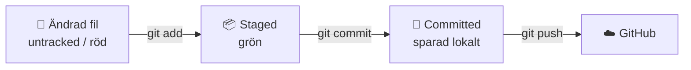

# Git på 5 minuter 🚀

> För dig som är ny i kursen. Allt körs i **Terminal** (Mac) eller **Git Bash** (Windows).

## Så flyttar en fil genom Git



## 1. Starta ett repo

```bash
mkdir mitt-projekt
cd mitt-projekt
git init
```

## 2. Spara en version

```bash
touch index.html
git status                          # röd = untracked
git add index.html
git status                          # grön = staged
git commit --message "Skapat index.html"
```

## 3. Se historiken

```bash
git log --pretty=oneline
```
```
d400f9f (HEAD -> master) Lagt till h2
5313b0d Skapat index.html
```

## 4. Backa till en gammal version ⏪

```bash
git checkout 5313b0d index.html     # 4–7 tecken av hashen räcker
```

## 5. Testa utan risk – branch 🌿

```bash
git branch develop
git checkout develop                # jobba här...
git checkout master
git merge develop                   # ...ta in ändringarna
```

## 6. Ladda upp till GitHub ☁️

```bash
git remote add origin https://github.com/ANVÄNDARNAMN/REPO.git
git push -u origin master
```

## ⚠️ Vanliga misstag

| Problem | Lösning |
|---|---|
| `dquote>` i terminalen | Du glömde ett `"`. Tryck **Ctrl + C** och skriv om. |
| `Repository not found` | Fel användarnamn i adressen. Kolla med `git remote -v`. |
| GitHub vill ha lösenord | Använd `gh auth login` istället. |
